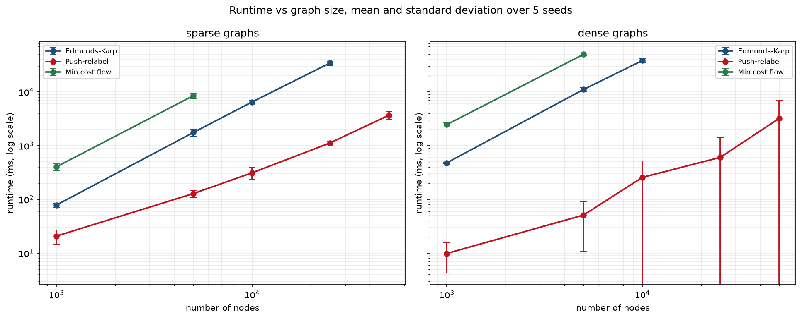
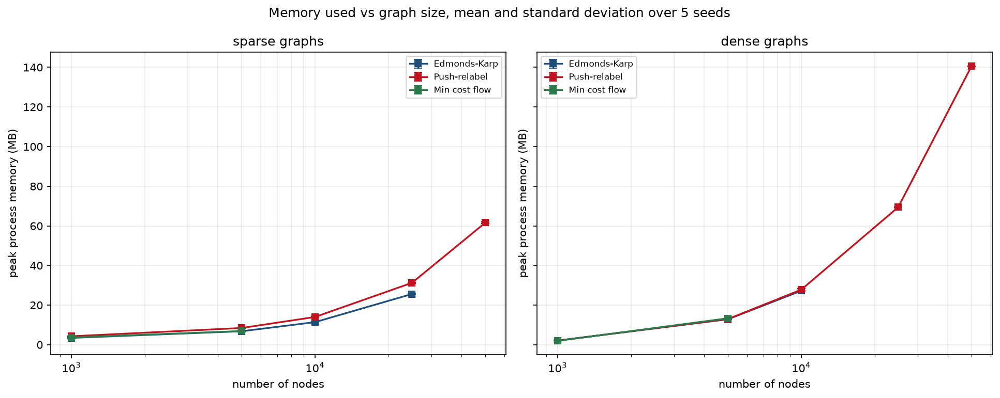
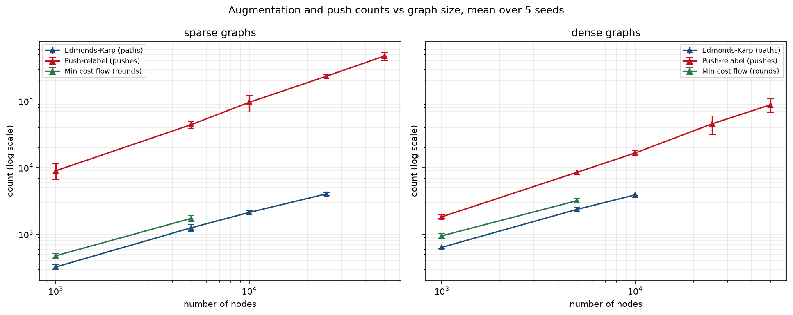
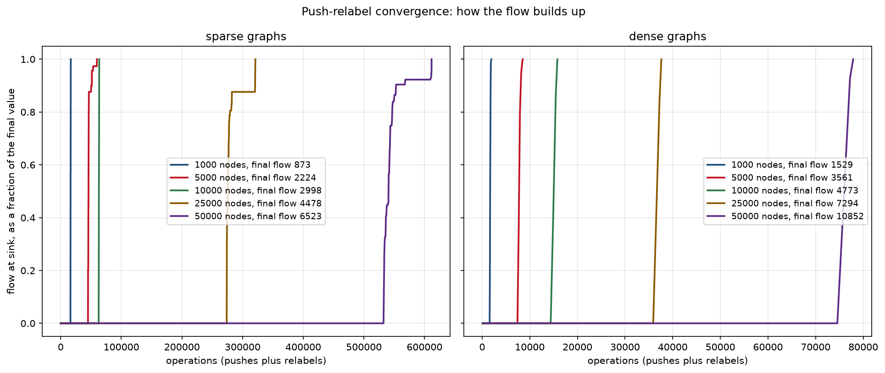

# CSC 5300 Week 10 Report: Network Flows, Matching, and Large Scale Graph Optimization

Omar Vasquez
Concordia University Texas, MCS
CSC 5300 Advanced Algorithms, Dr. Amakobe

## Executive Summary

I built a flow network solver that puts Edmonds-Karp, push-relabel, and min cost max flow on one shared graph structure, then used those solvers for bipartite matching, image segmentation by graph cuts, and scheduling. The project has 120 passing tests and benchmarks five seeds at five sizes on two graph families. Push-relabel is the only one that reaches the assignment's target of 50,000 vertices. It finished 50,000 sparse nodes in 3,993.6 ms mean with a standard deviation of 610.6 ms, and 50,000 dense nodes in 3,060.6 ms mean with a standard deviation of 3,487.2 ms. Edmonds-Karp ran out of its 120 second budget on all five seeds at 50,000 sparse nodes and at 25,000 and 50,000 dense nodes. Min cost flow solves the harder problem, so I only ran it up to 5,000 nodes. Every solver that finished returned the same flow value on the same graph.

## Theory Overview

A flow network is a directed graph with a capacity on each edge, a source, and a sink. A flow is legal when it never exceeds a capacity and when every vertex except the source and the sink sends out what it takes in. Max flow asks for the largest value out of the source. I followed CLRS Chapter 26 for definitions and algorithms.

The residual graph is the key idea. For an edge with capacity c and flow f I keep the leftover c minus f forward and f backward. The backward edge lets a solver undo an earlier bad choice without starting over. An augmenting path is a path from source to sink with room left on every edge, and pushing the smallest leftover along it raises the flow and keeps it legal. When no augmenting path is left the flow is maximum, and the vertices still reachable from the source form a cut whose capacity equals the flow value. That is the max flow min cut theorem, and how I test the solvers against each other.

Push-relabel works in a different order. It starts by filling every edge out of the source, which makes a preflow that can break conservation in the middle. A vertex holding too much flow is active. An active vertex either pushes to a neighbor one level lower or raises its label. The last step sends leftover excess back to the source, because otherwise the answer is a preflow and the cut capacity comes out wrong. That was a real bug I hit and fixed.

Min cost flow puts a cost on each unit of flow and asks for the cheapest way to reach a given flow value. I use successive shortest paths with Johnson potentials so Dijkstra still works when residual edges have negative costs.

## Algorithm Comparison

Edmonds-Karp is the easiest to explain and trust. It finds the shortest augmenting path by breadth first search, so the bound is O(V E squared). The price is a full BFS per augmentation. At 1,000 sparse nodes it took 68.5 (7.5) ms and 322.6 augmentations. At 25,000 sparse nodes it took 81,912.9 (4,725.0) ms and 4,034.2 augmentations. The work per augmentation grows because each BFS looks at more edges.

Push-relabel makes the opposite trade. It does far more augmentations, but each is local. At 1,000 sparse nodes it made 8,983.6 augmentations against 322.6 for Edmonds-Karp, and still finished in 18.5 ms against 68.5 ms. At 50,000 sparse nodes it made 474,766.6 augmentations in 3,993.6 ms. A push touches one edge while a BFS touches the whole graph, so cheap work wins once the graph gets big. I use the highest label variant with global relabeling and the gap heuristic.

Min cost flow is slowest per node, which fits because it solves a harder problem. At 1,000 sparse nodes it took 373.1 ms with 475.2 augmentations, and at 5,000 sparse nodes 12,338.5 ms with 1,727.4 augmentations. On dense graphs it was 2,362.1 ms at 1,000 nodes and 72,475.8 ms at 5,000. Each augmentation is a Dijkstra search plus a potential update.

## Applications

Bipartite matching becomes max flow when I add a source to the left side and a sink to the right side. All capacities are one, so any integral flow is a set of pairs with no vertex used twice, and the flow value is the matching size. On small cases I compared against brute force over every matching and the answers matched. A weighted version uses costs and min cost flow for the best total weight, not the largest count.

Image segmentation treats each pixel as a vertex and links neighbors with a capacity that measures similarity. A source edge and a sink edge carry how likely that pixel is to be foreground or background. The minimum cut is the boundary, and the pixels on the source side are the mask. On my synthetic 48 by 48 test image the cut capacity was 28.27 and the mask matched the known rectangle 0.9987 of the way, so 588 of 2,304 pixels came out as foreground.

Scheduling uses the same machinery for three shapes. Jobs to workers with a capacity per worker is a flow problem where the max flow is the number of hours that can be assigned. In the demo a tight instance asked for 18 hours and only 14 could be placed, and the flow reports that shortfall. Placing jobs into time slots is the same idea with slot capacities of one, and a tournament bracket is the third case.

## Performance Findings

All numbers are the mean and standard deviation over seeds 5300 to 5304 from `results/benchmark_summary.csv`, with a 120 second budget per run.

On sparse graphs, at 1,000 nodes Edmonds-Karp took 68.5 (7.5) ms, push-relabel 18.5 (3.2) ms, and min cost flow 373.1 (28.2) ms. At 5,000 nodes they took 1,723.7 (207.8), 133.6 (23.2), and 12,338.5 (2,019.1) ms. At 25,000 nodes Edmonds-Karp took 81,912.9 (4,725.0) ms against 1,429.7 (147.7) ms for push-relabel. At 50,000 nodes Edmonds-Karp timed out on every seed while push-relabel took 3,993.6 (610.6) ms.

On dense graphs, at 1,000 nodes the three took 455.7 (25.6), 10.6 (6.4), and 2,362.1 (240.2) ms, and at 5,000 nodes 18,199.5 (2,015.7), 75.7 (69.3), and 72,475.8 (5,743.2) ms. At 10,000 nodes Edmonds-Karp took 66,482.5 (1,761.8) ms against 240.6 (335.1) ms for push-relabel. Edmonds-Karp timed out at 25,000 and 50,000 dense nodes, and push-relabel finished those in 634.5 (903.8) and 3,060.6 (3,487.2) ms.

Three things stood out. Push-relabel wins at every size on both families and the gap widens with size. Second, memory grows with size for push-relabel: 4.2 MB at 1,000 sparse nodes, 15.3 MB at 10,000, 33.4 MB at 25,000, and 61.8 MB at 50,000. The dense family is heavier because it has more edges, from 5.6 MB at 1,000 nodes to 144.6 MB at 50,000.

Third, the flow values agreed exactly across every solver that finished the same graph, for example 934.2 at sparse 1,000 nodes and 4,568.2 at sparse 25,000 nodes, which is my main evidence the answers are right at scale.

The convergence profile is the result I did not expect. In `results/convergence_profiles.csv` the flow reaching the sink sits at zero for most of the operation count and then arrives near the end. At 50,000 sparse nodes the first nonzero sample is at operation 533,026 of 611,627, so 87 percent of the work happens before the sink sees any flow. At 5,000 sparse nodes it is 45,087 of 59,772. At 50,000 dense nodes the first nonzero sample is at 77,221 of 77,890, which is 99 percent. Push-relabel piles excess up in the middle of the network first, and a vertex can only push into the sink once its label is 1.

## Conclusion

The engineering lessons are mostly about the boring parts. My first push-relabel returned a preflow, and I only noticed because the cut capacity did not match the flow value, so I added a final pass that returns excess to the source plus a validator against the cut. The min cost flow code looked fine for a while but was quietly returning a cost slightly above the true optimum, which I caught by comparing against a linear program on small graphs. Seeded generators and a fresh process per measurement made the benchmark trustworthy. None of that shows up in a speed chart, but checking your answers and measuring honestly is what decides whether the project is right.

The scalability lesson is that the asymptotic difference is real. Edmonds-Karp is fine at 1,000 nodes and useless at 50,000, while push-relabel went from 18.5 to 3,993.6 ms over the same range. If I were shipping this, I would use Edmonds-Karp where the code is easy to audit and push-relabel for anything large. Min cost flow I would keep for small weighted problems.
